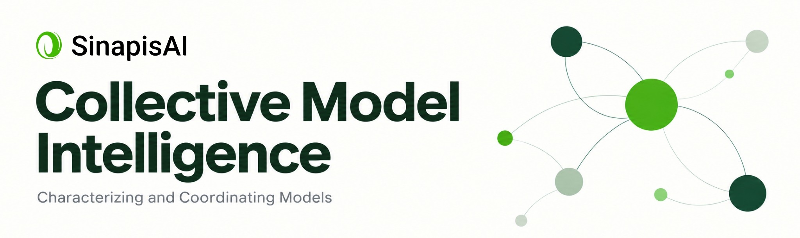
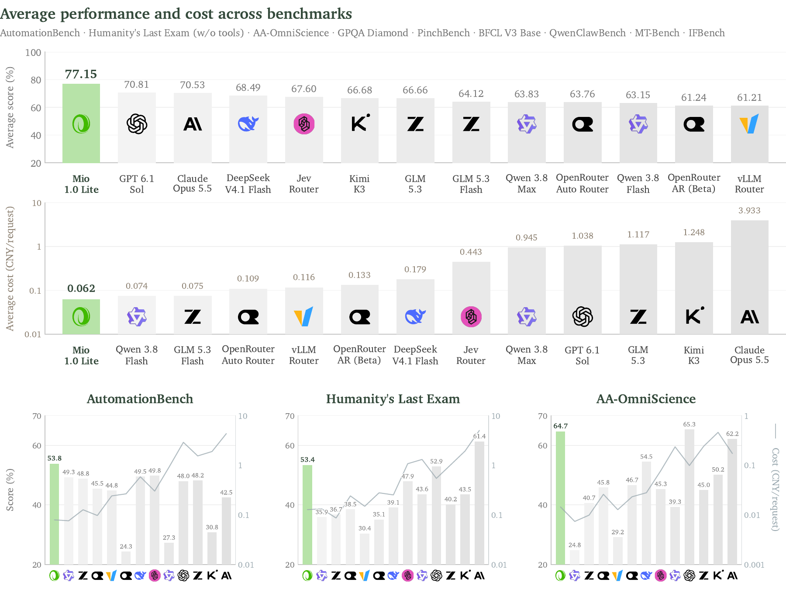
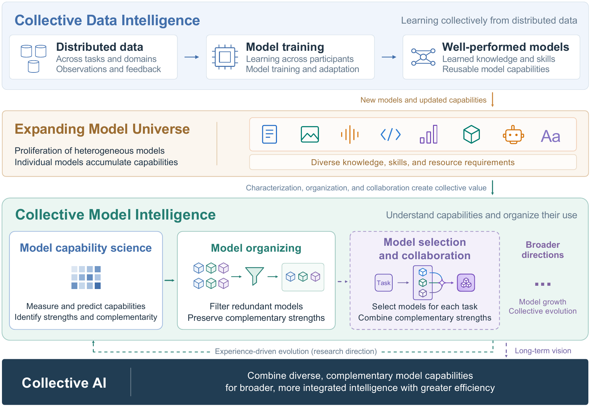
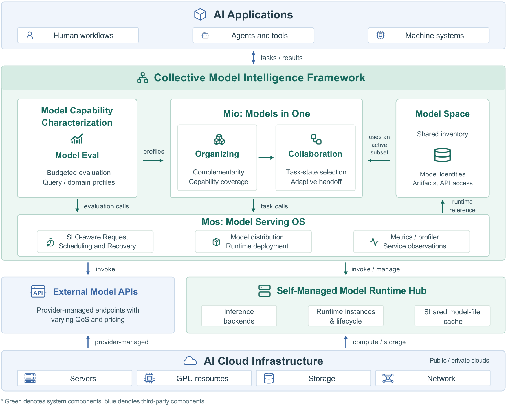

# Collective Model Intelligence

**Toward Collective Model Intelligence: Characterizing and Coordinating Models**

[**Tech Report**](tech-report.pdf) · [Results](docs/experimental-results.md) · [Try Mio](https://sinapis.ai) · [Open-Source Dataset](https://huggingface.co/datasets/SinapisAI/RobustRouteBench) · [中文](README.zh-CN.md)

## Mio 1.0 Lite

Across nine public benchmarks, Mio achieves **77.15/100** mean score at **0.0621 CNY/request**: the highest mean score and lowest mean cost among 13 compared methods. Benchmarks are weighted equally; these are the report's [offline evaluation results](docs/experimental-results.md#mio-10-lite-public-benchmarks).



## From individual models to collective intelligence

**Collective Model Intelligence** aims to improve task outcomes and resource efficiency by understanding, reusing, and coordinating capabilities across an evolving population of independently developed models. The key is complementarity: a specialist can supply a missing capability, and different models can contribute at different stages as task needs and remaining cost and latency budgets change.



## System Architecture Overview



- **Model Eval** builds capability profiles through query-level score estimation and cross-domain prediction.
- **Mio (Models in One)** organizes complementary models and selects or coordinates them using task state and remaining budgets.
- **Mos (Model Serving OS)** schedules and executes evaluation and application calls, and manages deployment and model-file distribution for self-managed models.

**Model Space** provides shared model identities and resource references, linking capability evidence, candidate pools, and execution.

## RobustRouteBench

RobustRouteBench contains **35,278 instances** across General Text (63 candidate models), Multimodal (45), and Chinese (10). Final report scoring retains **18,982 requests** after excluding development source groups and linked variants.

Use **Python 3.10+**. The examples need no model API key.

```sh
git clone https://github.com/SinapisAI/collective-model-intelligence.git
cd collective-model-intelligence
python -m venv .venv
source .venv/bin/activate
python -m pip install -e '.[data,orbit]'
python examples/quickstart.py --scenario text  # train and evaluate on validation
```

Other scenarios: `--scenario multimodal` or `--scenario chinese`.

Replay the **65 prediction runs across 13 methods** with the report's split exclusions and nominal-budget nAUC:

```sh
python -m examples.reproduce_report --mode replay --output runs/report-replay
```

[Dataset and protocol](benchmark/README.md) · [Reproduction guide](docs/reproducibility.md) · [Comparison methods](methods/README.md)

## Citation and license

```bibtex
@techreport{sinapisai2026collectivemodelintelligence,
  title       = {Toward Collective Model Intelligence:
                 Characterizing and Coordinating Models},
  author      = {{SinapisAI Team}},
  institution = {SinapisAI},
  year        = {2026},
  url         = {https://github.com/SinapisAI/collective-model-intelligence}
}
```

Citation metadata: [CITATION.cff](CITATION.cff). Code uses [Apache-2.0](LICENSE), with [MIT-licensed ORBIT components](methods/orbit/LICENSE). The dataset follows its [upstream terms](https://huggingface.co/datasets/SinapisAI/RobustRouteBench/blob/e05b897bf3b92bc9913409959a150f75cecbb427/LICENSES.md); report materials and embedded logos retain their attribution.
